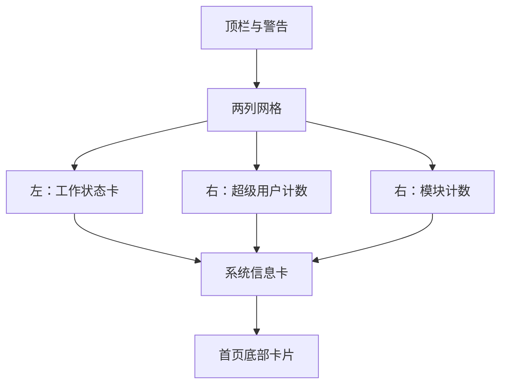

# Grid 主题概览

<Badge text="双列卡片" type="tip" /> <Badge text="工作卡可独立换图" type="info" /> <Badge text="始终两列" type="warning" />

GridUI 的 token 是 `kernelsu`。首页顶部固定为两列：左侧工作状态卡，右侧纵向堆叠超级用户与模块计数。系统信息卡和底部卡片在下方。

## 页面结构



两列使用相同权重，工作卡高度由本行内容决定。它不会在窄屏自动变成单列；这是 Grid 与 Focus 响应式重排的主要区别。

## 计数可用性

计数卡始终占据位置，但只有完整功能环境且 Root 可用时才显示数字。不可用时保留占位，避免页面布局跳动。

可用的计数卡：

- 超级用户数量；
- 已启用模块数量。

## 工作卡 surface

Grid 是第一个拥有完整工作卡 surface 的布局：

```text
surface.layout.grid.workCard.*
图片基础名：grid_working_card_background
```

它可以独立启用图片、调整不透明度、设置日夜不透明度、暗度，并隐藏图标、标题和运行模式标签。

StatsUI 顶部选择 `grid` 时也会复用同一个工作卡 surface；Stats 顶部选择 `list` 时则使用标准状态卡，不使用该 surface。

## 布局选择

在“设置 → 外观 → 布局 → 首页布局”中选择 GridUI。主题 JSON 使用 `kernelsu`。

:::: warning 名称不是 token

界面显示 GridUI，但历史协议 token 是 `kernelsu`。写主题时应使用 `homeLayoutStyle: "kernelsu"`，不要臆造 `grid`。

::::

## 页面

- [基础样式](/theme/theme-grid/basic/)
- [背景设置](/theme/theme-grid/background/)
- [工作卡片](/theme/theme-grid/working-card/)
- [组件隐藏](/theme/theme-grid/component-hiding/)
- [动画与交互](/theme/theme-grid/interaction/)
