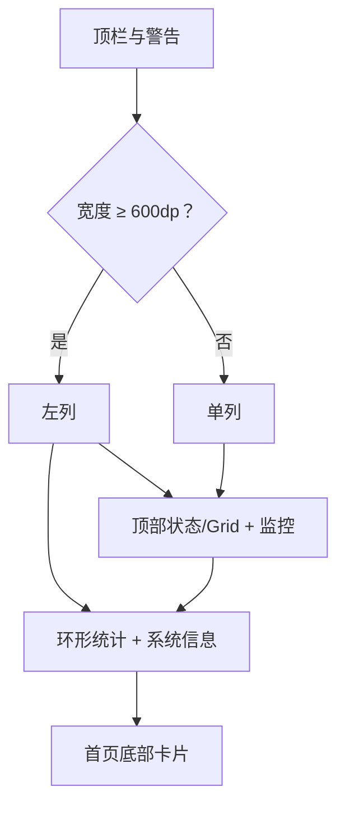

# StatsUI 主题概览

<Badge text="实时监控" type="tip" /> <Badge text="顶部可切 list/grid" type="info" /> <Badge text="宽屏两列" type="warning" />

StatsUI 的 token 是 `stats`。它把顶部状态、设备监控、三类计数环形图和系统信息组合成一个信息密集的首页。

## 结构

Stats 的宽屏判断只要求宽度至少 600dp，不要求宽大于高。这与 Focus 的方向条件不同。

## 顶部布局

`statsTopLayout` 有两个正式设置：

::::: field-group

:::: field 列表样式
@type `list`
顶部使用标准状态卡。Circle 的“隐藏状态标签”设置在这里也可见，用于隐藏 `LKM` / `Built-In` 标签。
::::

:::: field 网格样式
@type `grid`
顶部复用 Grid 工作卡与两张计数卡，共用 `surface.layout.grid.workCard` 配置。
::::

:::::

设置入口：“设置 → 外观 → 布局 → 顶部布局”，只有当前首页为 StatsUI 时显示。

## 四个主要区域

:::: table Stats 卡片

| 区域 | 内容 |
| --- | --- |
| 顶部 | 标准状态卡，或 Grid 工作卡 + 计数 |
| 监控 | CPU 温度波形、RAM 波形、CPU 集群、电池、zram、swap |
| 环形统计 | 模块、超级用户、插件数量 |
| 系统信息 | 管理器、内核、设备、SELinux、Seccomp 与可选能力 |

::::

Stats 没有监控卡图片 surface；它的可主题化图片主要来自页面背景，以及顶部选择 Grid 时的 Grid 工作卡。

## 采样

只有首页为当前页且布局为 Stats/Focus 时持续采集指标。每 5 秒一次，保留 30 个样本。离开页面后停止。

## 页面

- [基础样式](/theme/theme-statsui/basic/)
- [硬件监控](/theme/theme-statsui/hardware/)
- [统计信息](/theme/theme-statsui/statistics/)
- [动画与交互](/theme/theme-statsui/interaction/)
