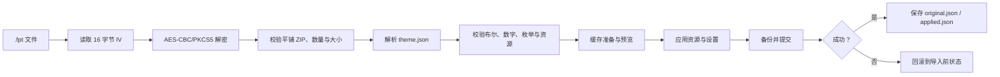

# 主题预览与使用

<Badge text="只改管理器外观" type="tip" /> <Badge text=".fpt 不是签名" type="danger" /> <Badge text="兼容 FolkPatch 主题字段" type="warning" />

FinaSU 主题只改变管理器的显示与交互资源，不改变 Root 授权、App Profile、模块列表、内核配置或挂载结果。一个主题包可以同时包含颜色、背景、字体、首页布局、导航图标、音乐和音效，但每项功能都必须满足自己的启用条件。

==下载主题不等于已经应用主题。==主题商店下载完成后仍需经过确认和 `.fpt` 导入流程；只把文件保存到下载目录也不会立即改变管理器。

## 从哪里进入

:::: table 主题相关入口

| 要做的事 | 入口 | 说明 |
| --- | --- | --- |
| 选择布局、底部卡片与标题 | 设置 → 外观 → 布局 | 布局和首页信息属于管理器设置 |
| 修改明暗模式与颜色 | 设置 → 外观 → 主题设置 | 可选择系统、浅色、深色和 AMOLED |
| 设置壁纸、视频和主题包 | 设置 → 外观 → 壁纸 | 导入、导出、恢复默认主题也在这里 |
| 修改字体 | 设置 → 外观 → 字体 | 软件默认、系统默认或自定义文件 |
| 浏览在线主题 | 设置 → 外观 → 主题商店 | 内置下载或浏览器兼容模式 |
| 修改音乐、音效和振动 | 设置 → 多媒体 | 振动不属于 `.fpt` 主题资源 |

::::

## 五套首页布局

:::: table 实际布局 token 与结构

| 界面名称 | 主题 JSON token | 首页结构 | 实时指标 |
| --- | --- | --- | --- |
| CircleUI | `circle` | 单列状态卡；完整环境下再显示两张计数卡 | 不持续采样 |
| GridUI | `kernelsu` | 左工作卡、右侧竖向两张计数卡 | 不持续采样 |
| FocusUI | `focus` | 状态、管理器、设备、存储四张卡 | 持续采样 |
| DashboardUI | `dashboard_ui` | 宽幅 Hero、两张计数卡、系统信息 | 不持续采样 |
| StatsUI | `stats` | 顶部状态/网格、监控、环形统计、系统信息 | 持续采样 |

::::

FolkPatch 主题中的 `default` 和 `sign` 会映射为 FinaSU 的 `circle`；`kernelsu`、`focus`、`dashboard_ui` 和 `stats` 直接对应。未知布局 token 不会强行覆盖当前布局，并会在导入时产生警告。

## 主题商店

主题商店读取 FolkPatch 兼容的在线主题索引。两种模式只改变“主题怎样到达设备”，不改变索引浏览、搜索和筛选。

首次进入商店时会要求选择下载方式；之后可在“设置 → 外观 → 主题商店模式”中修改。

::::: field-group

:::: field 内置模式
@type `应用内下载`
在应用内显示下载进度，可暂停、继续或取消。`.fpt` 与预览图分别下载，预览失败不会破坏主题文件。下载完成后可直接进入同一个主题导入确认框。
::::

:::: field 兼容模式
@type `浏览器回退`
点击下载后把主题链接交给浏览器。保存 `.fpt` 后，再从文件管理器用 FinaSU 打开，或回到壁纸页手动导入。适合内置下载或文件导入流程不稳定的设备。
::::

:::::

内置模式会把主题保存在管理器私有目录 `filesDir/themes/<作者>/<名称>/`，并写入 `theme_meta.json`。地址中的作者和名称会先替换文件系统非法字符，避免直接形成目录穿越。

兼容模式由浏览器接管下载，因此商店不显示“我的主题”入口；请按普通 `.fpt` 文件保存并通过系统文件选择器导入。

商店支持：

- 按名称、作者和说明搜索；
- 按作者、官方/第三方来源筛选；
- 同时选择手机或平板类型；
- 下拉刷新；
- 最多同时进行三个主题下载任务；
- 最多重试三次，暂停后通过 HTTP `Range` 尝试断点续传；
- 在“我的主题”中搜索、重新应用或删除本地主题。

:::: warning 页面显示“已完成”不等于主题一定兼容

下载器只检查文件大小、最小长度和 AES-CBC 容器长度。真正的 ZIP 结构、`theme.json`、资源与字段验证发生在导入阶段。下载成功但导入失败时，应查看导入错误，而不是反复点击“应用”。

::::

## 导入主题

:::: steps

1. **取得 `.fpt` 文件**

   从可信来源下载，确认文件没有被聊天软件、网盘或下载器改名成 `.zip`、`.bin` 或其他后缀。

2. **在应用中打开**

   可以从主题商店点击“应用”，也可以在文件管理器中用 FinaSU 打开，或从“设置 → 外观 → 壁纸 → 导入主题包”选择文件。

3. **检查预览与元数据**

   确认主题名称、作者、版本、手机/平板类型和资源数量。预览图只用于辨认主题，不代表全部资源一定可解码。

4. **确认应用**

   如果启用了应用锁，导入会先要求通过主题导入认证。确认后，管理器先在缓存目录准备主题，再以事务方式应用。

5. **检查实际结果**

   依次查看首页布局、颜色、壁纸、字体、导航图标、音乐和音效。缺失资源通常会回退或产生警告，不会把不存在的文件伪装成成功。

::::

导入流程可以概括为：

主题应用会先保存当前资源与设置的备份。认证通过后才开始应用；任一步失败会尝试回滚。语言切换放在最后执行，因为 Android 13 及以上可能由系统重建 Activity。

## 主题能改什么

::::: collapse accordion

:::: collapse 背景与布局
主壁纸、五种分页背景、视频背景、高级标题图、Grid 工作卡、Focus 四张卡、Dashboard Hero、布局 token、Stats 顶部布局。
::::

:::: collapse 颜色与文字
明暗模式、强调色、精确 ARGB 种子、色彩标准、色彩风格、对比度字段、标题文字模式与自定义标题。
::::

:::: collapse 资源
图片、GIF、字体、视频、导航图标、背景音乐和触摸音效。扩展名优先级由主题资源策略决定。
::::

:::: collapse 语言
`appLanguage` 使用 BCP-47 标签。字段缺失时保留当前语言；显式空字符串表示恢复跟随系统。缺少对应翻译时仍回退到 Android 资源。
::::

:::: collapse 不会被主题修改
Root 授权、App Profile、模块启用状态、SUSFS 规则、内核配置、备份密码、应用锁凭据和振动设置。
::::

:::::

## 与 FolkPatch 主题的关系

FinaSU 复用了 FolkPatch 生态的 `.fpt` 容器、大量历史 JSON 键、布局 token 和 surface 兼容键，因此两边的主题可以在很多情况下互相导入。这个兼容关系有明确边界：

- `default` 与 `sign` 是 FolkPatch 历史布局值，FinaSU 将它们解释为 CircleUI；
- FinaSU 会优先读取自己的 `surface.<id>.<field>` 键，同时回退到历史兼容键；
- 未识别字段和不使用的资源会保留在 `theme_passthrough/`，便于再次导出；
- FinaSU 的任意 ARGB 种子、标题字段等扩展不一定能被其他实现完整解释；
- 跨端中转可能丢失扩展键或改变关闭状态/资源描述，不能视为无损同步；
- 两边对缺失字段、默认值和某些开关的语义可能不同，发布前必须实际回导测试。

==“.fpt 可以打开”只证明容器和基础字段可读，不证明所有视觉语义完全一致。==

更完整的容器、字段和兼容矩阵见[主题包结构](/developer/theme-package/)。

## 恢复默认主题

“设置 → 外观 → 壁纸 → 恢复默认主题”会执行一组完整重置：

- 清除主壁纸、分页背景、视频、标题图与 surface 图片；
- 清除自定义字体与导航图标；
- 清除音乐、音效和主题表面配置；
- 重置布局、Stats 顶部布局、状态标签隐藏和颜色相关设置；
- 清除主题设置的应用语言，恢复跟随系统。

恢复后的颜色相关默认值包括：跟随系统、`keyColor = 0`、系统动态色可用、TonalSpot、2025 色彩规范、`custom` 生成模式、标准对比度。Root 授权、模块、App Profile 和振动不受影响。

:::: danger 重要当前状态先导出

恢复默认主题会清除多个偏好项。若当前主题经过长期调整，应先导出 `.fpt`，并单独记录应用锁、Root 授权等不属于主题的内容。

::::

## 安全边界

`.fpt` 使用固定对称密钥的 AES-CBC，只提供容器封装，不提供作者签名、来源认证或完整性认证。能读取应用代码的人可以构造或修改主题包。

- 不要因为主题来自主题商店就跳过元数据检查；
- 不要在主题中寻找可执行脚本或 Root 权限能力；
- 不要从不可信来源加载超大视频、字体或异常图片；
- 导入失败时保留原始文件，便于核对错误；
- 涉及管理器、内核或模块异常时，先恢复已知可用主题，再按排错流程处理。

:::: chat title="主题使用快速问答"
{用户}
主题商店下载完，为什么首页没有变化？

{.}
下载只把 `.fpt` 放进本地主题库。还要在完成提示中点击“应用”，或到“我的主题”里选择该主题并确认导入。

{用户}
主题包能证明作者身份吗？

{.}
不能。`.fpt` 没有签名验证机制。作者、版本和商店来源都只是元数据，不能替代可信下载渠道。

{用户}
为什么导入后某个开关没有变化？

{.}
可能缺少该字段、枚举不受支持、资源缺失，或当前布局根本不使用该功能。先查看导入警告和当前布局的专属页面。

{用户}
恢复默认后会删除 Root 授权吗？

{.}
不会。它清理的是主题资源与主题相关偏好，不修改 allowlist、App Profile、模块列表或内核设置。
::::

## 继续阅读

- [成为主题开发者](/theme/theme-dev/)：制作、验证和分发主题。
- [导出主题](/theme/export/info/)：导出范围、保存位置与限制。
- [分享主题](/theme/export/share/)：跨设备分发和导入注意事项。
- [夜间模式与颜色](/theme/global/theme-style/)：颜色字段与 UI 的真实对应关系。
- [首页与布局](/setting/home/)：布局、底部卡片、标题和信息显隐。
