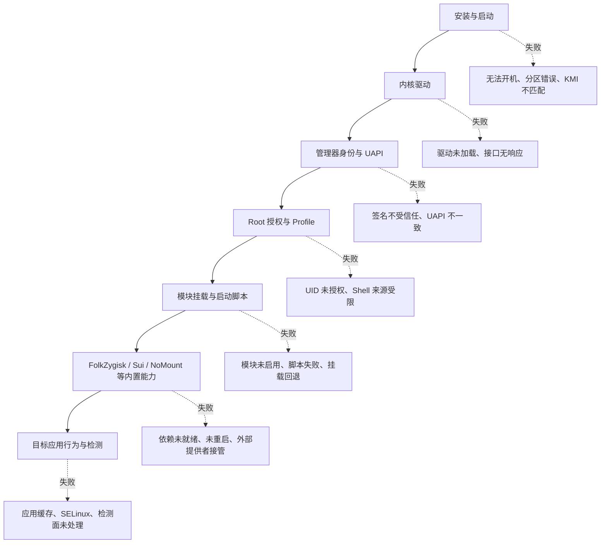
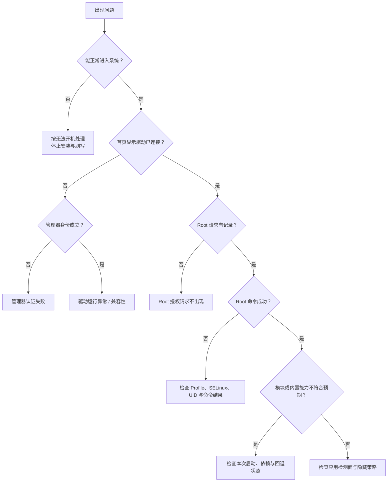

# 排错总览

<Badge text="先定位层级" type="tip" /> <Badge text="不要急着刷机" type="warning" /> <Badge text="保留证据" type="danger" />

排错不是把能想到的开关都试一遍。==先判断故障发生在哪一层==，再做一次可逆、可观察的改动，最后用同一操作验证结果。FinaSU 的驱动、`ksud`、管理器、模块和应用策略是不同层；某一层正常，不能证明其他层也正常。

::: danger 先看安全边界

只要设备已经出现启动循环、反复重启、黑屏或无法进入系统，就不要继续安装模块、切换内置能力或重复刷入未知镜像。先阅读[无法开机](/troubleshoot/bootloop/)和[救砖](/guide/rescue-bootloop/)。

:::

## 故障分层



层级之间的顺序不能随意颠倒。例如 Sui 不工作，先要确认 FinaSU 驱动可用、Zygisk 后端实际存在；应用检测到 Root，也不代表单靠“隐藏挂载记录”就能解决。

## 先找你的现象

:::: table 现象与入口

| 你看到的现象 | 先判断什么 | 去哪里 |
| --- | --- | --- |
| 刷入后不开机、启动动画循环、Recovery 可用或不可用 | 故障发生在启动链还是模块阶段 | [无法开机](/troubleshoot/bootloop/) |
| 管理器显示“未安装”“不支持”或没有驱动版本 | 设备条件、KMI、ABI、分区和构建是否匹配 | [设备兼容性](/troubleshoot/compatibility/) |
| 管理器能打开，但读写授权、模块或版本失败 | 管理器签名、动态管理器身份或 UAPI | [管理器认证失败](/troubleshoot/manager-auth/) |
| 应用请求 Root 后没有授权或仍提示无 Root | 请求是否到达、UID 是否命中、Shell 来源是否受限 | [Root 授权请求不出现](/troubleshoot/root-request/) |
| 驱动“已连接”但 `ksud`、模块或内置能力异常 | 用户态服务、运行模式或依赖链 | [驱动运行异常](/troubleshoot/runtime/) |
| 模块或 Zygisk 能从其他应用看到，但目标应用看不到 | App Profile、挂载过滤、NoMount 例外或 SELinux | [检测与隐藏](/troubleshoot/detection/) |
| 需要在反馈前导出日志、比较时间线或检查日志内容 | 日志是否完整、是否含敏感信息 | [日志与反馈](/troubleshoot/logs/) |
| 已经能复现问题，准备向维护者报告 | 如何给出最小但可处理的报告 | [提交问题报告](/troubleshoot/report/) |

::::

## 先分清四种“没生效”

“按钮没反应”“保存成功但功能没变”“当前内核不支持”和“预期本来就不会发生”是四类不同问题。把它们混在一起，往往会误删配置或反复刷机。

::::: field-group

:::: field 未运行
@type `运行状态`
配置要求该功能工作，但本次启动没有对应的守护进程、模块或提供者。先检查本次启动状态、依赖和失败记录。
::::

:::: field 不支持
@type `能力边界`
当前内核、架构、KMI 或构建没有提供该能力。安装更新的 APK 不一定能补上内核功能。
::::

:::: field 已保存，未应用
@type `生效时机`
设置已经写入持久配置，但功能要重启、重新打开目标应用或等新进程才读取。保存成功不等于当前进程已经改变。
::::

:::: field 本来就不会生效
@type `策略或范围`
例如应用已经允许 Root 时，非 Root Profile 的“卸载模块”不再控制该 UID；已有连接也不会被后来的网络隔离规则追溯切断。
::::

:::::

## 安全等级

:::: table 按风险选择操作

| 等级 | 例子 | 原则 |
| --- | --- | --- |
| **可现场观察** | 查看状态、刷新列表、打开 SU 日志、重启目标应用 | 先做；不改变持久配置 |
| **需要重启** | 启用模块、切换 Folk Mount 模式、启用 FolkZygisk 或 Sui | 一次只改一项，并记录改前状态 |
| **需要恢复镜像** | 错误启动分区、错误 KMI、内核无法启动、安全模式无法进入 | 停止猜测，按实际修改的分区刷回原厂镜像 |

::::

## 统一证据顺序

:::: steps

1. **写下最小现象**

   用一句话区分“打不开”“没授权”“授权后命令失败”“模块文件不可见”和“应用仍检测到 Root”。不要只写“不能用”。

2. **记录最后一次改动**

   包括安装或更新 APK、刷入启动镜像、切换安装方案、启停模块、改 App Profile、改隐藏选项和系统 OTA 的时间。

3. **确认当前启动方式**

   首页应说明当前是 LKM、Built-In、越狱模式还是安全模式。管理器 APK 能够打开，不代表驱动已经加载或管理器已经受信任。

4. **确认管理器身份和版本**

   只有管理器身份成立时，首页才会显示驱动版本、内核 UAPI 与管理能力。身份异常先看[管理器认证失败](/troubleshoot/manager-auth/)，不要先恢复全部模块。

5. **确认 Root 请求和 UID**

   在超级用户页核对包名、Android 用户与 UID；在 SU 日志核对请求、授权和执行结果。多用户、分身、共享 UID 和重装应用都可能改变身份。

6. **记录本次启动状态**

   模块、Folk Mount、FolkZygisk、Sui、NoMount 和 UTS View 都可能区分“下次启动配置”和“本次启动结果”。先看当前启动，再看持久设置。

7. **只改一项并复现**

   一次只关闭最近新增的能力、恢复一个 Profile 或启用一个模块。每次改动后使用同一路径复现，避免把多个变量混在一起。

8. **最后再导出完整日志**

   先在设备上确认时间点和失败文本，再导出日志包。完整日志包含大量环境与隐私信息，应在复现后立即保存，而不是等日志滚动覆盖。

::::

## 先做哪些检查

管理器界面优先，因为它能同时显示身份、运行模式、模块状态和能力门控：

:::: code-tabs

@tab:active 身份与驱动

```text
管理器 → 首页
检查：运行方式、驱动版本、UAPI、Root Shell 状态、安全模式
```

@tab Root 授权

```text
管理器 → 超级用户 → 目标应用 / UID
检查：Root 开关、共享 UID、Android 用户、App Profile
```

@tab 模块与能力

```text
管理器 → 模块
管理器 → 设置 → 功能
检查：启用状态、本次启动提供者、失败/暂停/回退提示
```

@tab 事件与日志

```text
管理器 → 超级用户 → 左上角 SU 日志
管理器 → 设置 → 诊断与反馈 → 发送日志
```

::::

有 Root Shell 时，可用只读命令补充事实：

```sh
/data/adb/ksud boot-info current-kmi
/data/adb/ksud boot-info supported-kmis
/data/adb/ksud nomount status --json
```

这些命令用于记录事实，不要为了“修复”而直接调用内部 ioctl、手工加载来源不明的 `.ko` 或编辑 `/data/adb/ksu` 中的状态文件。

## 不要这样排错

:::: collapse accordion

### 一上来清空 `/data/adb`

这会删除模块、授权、Profile、动态管理器登记和日志，症状可能消失，但原因也被一并删掉。除非维护者明确要求并已备份，否则不要这样做。

### 同时关闭所有隐藏功能

关闭全部隐藏项会扩大系统暴露面，也无法证明具体是哪一项导致故障。先确认故障是“应用看不到自己的文件”还是“检测程序仍发现 Root”，只回退最近改动的一项。

### 反复刷入同一个失败镜像

如果故障发生在启动链，重复刷入只会反复进入同一失败路径。先确认分区、KMI、槽位和镜像来源，再恢复原厂镜像。

### 把“没有弹窗”当作唯一证据

授权界面是否出现受管理器进程、应用请求路径、UID 和现有 Profile 影响。更可靠的是 SU 日志、Root 请求结果与目标应用实际执行结果。

### 用不同版本的管理器、`ksud` 和驱动拼凑

三者的 UAPI 与启动镜像必须匹配。手工复制其他包的 `ksud` 或 `.ko` 可能让管理器能打开，但后续请求失败，甚至导致无法启动。

::::

## 一个最小排查树



## 相关页面

- [无法开机](/troubleshoot/bootloop/)：区分启动链故障与模块故障。
- [设备兼容性](/troubleshoot/compatibility/)：KMI、ABI、启动分区和构建矩阵。
- [管理器认证失败](/troubleshoot/manager-auth/)：签名、动态管理器和 UAPI。
- [Root 授权请求不出现](/troubleshoot/root-request/)：请求、UID、Shell 与 Profile。
- [驱动运行异常](/troubleshoot/runtime/)：`ksud`、模块、内置能力和运行模式。
- [检测与隐藏](/troubleshoot/detection/)：各隐藏手段能处理什么，不能处理什么。
- [日志与反馈](/troubleshoot/logs/)：诊断日志、命令与隐私。
- [提交问题报告](/troubleshoot/report/)：可复制的报告模板。
