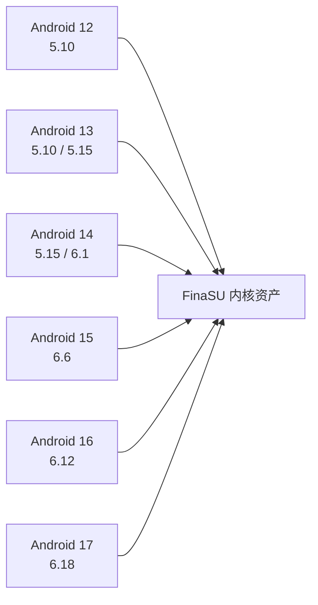

# 设备兼容性

<Badge text="版本不是 KMI" type="warning" /> <Badge text="按完整构建判断" type="tip" /> <Badge text="不要混刷" type="danger" />

兼容性不是“Android 版本够新”这一项。至少同时涉及设备架构、KMI、启动镜像布局、内核配置、安装方式、管理器签名和当前内核 UAPI。任何一项不匹配，都可能表现为“管理器打不开”“驱动不加载”“刷入后不能开机”或“只有某个内置能力不可用”。

::: important 先记录六个事实

设备型号、Android 构建、完整内核版本、KMI、ABI、当前槽位。只记录“Android 15”或“内核 6.6”不足以判断 LKM 是否匹配。

:::

## 当前源码中的 KMI 矩阵

仓库的 CI 和随包资产按下列 KMI 构建 `kernelsu.ko` 与 `nomount.ko`：



:::: table 当前构建矩阵

| KMI 标识 | 与 Android/Kernel 的对应 |
| --- | --- |
| `android12-5.10` | Android 12，Linux 5.10 |
| `android13-5.10` | Android 13，Linux 5.10 |
| `android13-5.15` | Android 13，Linux 5.15 |
| `android14-5.15` | Android 14，Linux 5.15 |
| `android14-6.1` | Android 14，Linux 6.1 |
| `android15-6.6` | Android 15，Linux 6.6 |
| `android16-6.12` | Android 16，Linux 6.12 |
| `android17-6.18` | Android 17，Linux 6.18 |

::::

这张表描述的是**当前仓库的构建资产**，不是对所有 Android 设备的永久承诺。设备仍可能使用厂商内核、不同符号导出、不同内核配置或修改过的版本字符串。

::: warning 本地构建默认只有一个 KMI

`build.sh` 的本地默认 `KMIS` 是 `android15-6.6`。只跑一次本地 `lkm` 构建，得到的 APK 或驱动只适合该 KMI。完整的多 KMI 包需要使用发布构建矩阵，或显式扩大 `KMIS`。

:::

## ABI 与内置载荷

:::: table 当前 CI 资产范围

| ABI | 驱动/NoMount | `ksud` | FolkZygisk | Sui |
| --- | --- | --- | --- | --- |
| `arm64-v8a` | 提供当前 KMI 矩阵 | 提供 | 提供 64 位与 32 位注入资产 | 提供 |
| `x86_64` | 提供当前 KMI 矩阵 | 提供 | 提供 64 位与 32 位注入资产 | 提供 |
| `riscv64` | 当前发布矩阵不提供 | 提供 | 不提供 | 不提供 |

::::

不要把 `ksud` 能否运行与完整能力支持混为一谈。`riscv64` 当前可以构建 `ksud` 与 `ksuinit`，但仓库的发布构建没有对应 KMI 的 KernelSU/NoMount 模块，也没有 Sui 与 FolkZygisk 载荷；管理器应显示载荷缺失，而不是假装可用。

架构错误通常更直接：

- 64 位设备不能加载 32 位内核模块；
- x86_64 设备不能使用 arm64 的 `ksud` 或 `.ko`；
- 多 ABI 应用可能同时包含 32 位和 64 位进程，Zygisk 注入结果可能因此不同。

## 启动分区与安装方案

::::: field-group

:::: field LKM
@type `修改 ramdisk`
目标通常是 `init_boot`；没有独立 `init_boot` 或 KMI 为 `android12-*` 时通常是 `boot`。安装页若明确支持手动选择，才考虑其他分区。
::::

:::: field Built-In
@type `替换内核`
需要一个已经编入 FinaSU 驱动的完整内核，通常通过 `boot` 刷入。内核、vendor 模块和系统构建必须属于同一套兼容版本。
::::

:::: field 越狱模式
@type `运行后加载`
不修改启动分区，但仍要求运行中的内核与目标 `.ko` 的 KMI、架构和符号兼容。
::::

:::::

::: danger 解锁 Bootloader 不等于可以随便刷

部分设备还有 AVB、厂商完整性校验、防回滚或分区保护。Bootloader 已解锁，也可能因为验证链或错误镜像无法启动。设备是否需要额外处理，应以厂商固件和实际启动结果为准。

:::

## 为什么“都是 6.6”仍可能不兼容

KMI 标识是 ABI 兼容层的一部分，不是完整的构建指纹。即使两个设备都报告 `android15-6.6`，仍可能有以下差异：

- 厂商内核没有导出 FinaSU 需要的符号；
- 内核配置关闭了某个功能或编译选项；
- 内核改了结构体、hook 点或 syscall 实现；
- 模块 vermagic、架构或签名与当前内核不一致；
- Built-In 源码与目标内核版本、补丁或配置不匹配。

因此：

- LKM 失败时先核对确切的 KMI 资产、架构和启动分区。
- Built-In 失败时不能只比对 KMI，要核对完整内核源码和配置。
- 某个功能不可用不等于整个驱动不可用；例如网络隔离、UTS View、挂载视图过滤或 SUSFS 对接都有独立能力门控。

## 设备端的判断路径

:::: steps

1. **看首页运行方式**

   驱动连接后，首页显示 LKM、Built-In 或越狱模式。没有驱动版本时先看[管理器认证失败](/troubleshoot/manager-auth/)；管理器能打开不等于身份成立。

2. **核对完整内核版本**

   使用管理器信息卡或终端读取 `uname -r`。保留完整的 Android/KMI 标记，不要只写主版本号。

3. **核对 KMI**

   有 Root Shell 时执行：

   ```sh
   /data/adb/ksud boot-info current-kmi
   /data/adb/ksud boot-info supported-kmis
   ```

   第一条显示当前识别结果，第二条显示当前安装包实际携带的驱动 KMI。

4. **核对 ABI**

   确认设备不是 32 位-only，且安装包包含与系统内核一致的架构资产。Zygisk 和 Sui 还要看目标应用使用的 ABI。

5. **核对安装目标**

   回到安装页、备份记录或刷写日志，确认实际修改的是 `boot`、`init_boot`、`vendor_boot` 还是未使用槽位。

6. **检查能力门控**

   如果只有某个功能显示“不支持”，先确认它是需要内核源码、内核配置、特定 KMI 资产，还是需要额外外部提供者。

::::

## 状态词的含义

:::: table 不要把这些状态混为一谈

| 显示 | 含义 | 下一步 |
| --- | --- | --- |
| **未安装** | 管理器没有检测到可用的 FinaSU 驱动，或当前没有安装身份 | 检查安装方式、分区和管理器身份 |
| **不支持** | 当前路径或设备条件不满足 | 先看具体能力/机型条件，不代表所有安装方式都不可能 |
| **驱动可用** | 管理器已连接内核接口 | 继续检查 Root 授权、`ksud` 和能力状态 |
| **UAPI 不匹配** | 内核与 `ksud` 或管理器期望的接口版本不同 | 安装匹配版本，不能靠重启消除 |
| **载荷缺失** | APK 没有当前 ABI/KMI 的资产 | 换完整发布包；本地构建可能只带一个 KMI |
| **能力不可用** | 驱动可能正常，但该功能缺少内核支持或依赖 | 查看对应内置能力页，不要强制写配置 |

::::

## 系统升级和 OTA

系统 OTA 可能替换内核、启动分区或整个槽位。更新后必须重新判断：

- 新系统是否仍属于同一 KMI；
- FinaSU 当前内核资产是否仍匹配；
- Built-In 是否要为新的内核源码重新构建；
- A/B 设备的活动槽位是否已经切换；
- 旧模块是否仍支持新的 Android 与内核。

对于 LKM，APK 更新不会自动更新已经刷入的启动镜像。对于 Built-In，安装新管理器也不会替换内核里的驱动。完整流程见[更新 FinaSU](/guide/update/)。

## 不兼容时不要做什么

:::: collapse accordion

### 用相邻 KMI 的模块碰运气

把 `android14-6.1` 的 `.ko` 强制加载到另一个 KMI，可能直接导致内核异常。vermagic 不匹配只是最早的一道检查，不是唯一风险。

### 修改版本字符串来骗过加载器

版本字符串相同不代表符号、结构体和 ABI 相同。强行绕过校验会扩大内核崩溃风险。

### 混用不同来源的管理器和驱动

管理器的签名信任、内核 UAPI 和 `ksud` 版本必须匹配。能安装 APK 不代表它能管理当前驱动。

### 把“某个功能不可用”当作“重装 APK 就能修”

内核缺少功能时，替换用户态 APK 不会补上内核代码。内置能力页会说明哪些依赖内核、哪些依赖外部模块。

::::

## 相关页面

- [安装与刷写](/guide/install/)：LKM、Built-In 与越狱模式的选择。
- [更新 FinaSU](/guide/update/)：APK、启动镜像与 OTA 的更新边界。
- [管理器认证失败](/troubleshoot/manager-auth/)：签名和 UAPI 的判断。
- [驱动运行异常](/troubleshoot/runtime/)：驱动连接后的运行问题。
- [内置能力总览](/builtin/)：各功能的内核与外部依赖。
