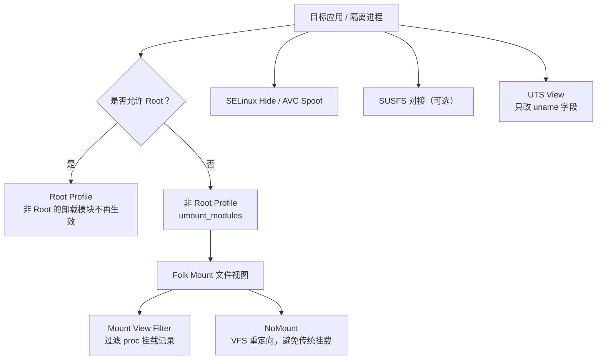

# 检测与隐藏

<Badge text="分层能力" type="warning" /> <Badge text="没有万能隐身" type="danger" /> <Badge text="先确认检测面" type="tip" />

FinaSU 没有单个开关可以保证通过所有应用检测。不同开关处理的是不同可观测面：模块文件视图、`/proc` 挂载记录、SELinux 修改、AVC 审计、内核版本字段或外部 SUSFS 能力。先确认目标应用实际看到什么，再选择对应层。

## 隐藏能力怎样分层

这些能力可能互相影响，但不是同一种“隐身等级”。例如 NoMount 减少传统挂载记录，Mount View Filter 过滤读到的挂载表，SELinux Hide 处理安全策略查询，UTS View 只改变指定进程的 `uname` 字段。

## App Profile 的“卸载模块”

默认非 Root Profile 的 `umount_modules` 为开启状态。它让没有获得 Root 的 UID 看到模块注入前的文件视图。

::: important 允许 Root 后，这个开关不再控制该 UID

内核判断某个 UID 允许 Root 时，==会跳过模块卸载==。此时 Root Profile 生效，`umount_modules` 是**非 Root Profile** 的字段。应用已经授权 Root，却还能看到模块文件，通常不是“卸载模块坏了”。

:::

适用范围：

- 目标 UID 未被允许 Root；
- 使用内置 Folk Mount 的传统模块文件视图；
- 共享 UID 时，策略影响整个 UID。

它不负责隐藏 `/proc` 中其他进程的挂载、进程列表、系统属性、SELinux 审计或应用自身保存的检测结果。

## Mount View Filter

“隐藏挂载记录”会在当前内核支持时过滤应用与隔离进程读取的 `/proc` 挂载视图，包括 `mounts`、`mountinfo` 和 `mountstats` 一类记录。过滤器会结合模块卸载策略与已知 Root/module 挂载路径判断。

:::: table 它能处理与不能处理的事情

| 能做到 | 不能保证做到 |
| --- | --- |
| 不向目标进程展示匹配到的模块或 Root 挂载记录 | 隐藏实际文件内容、打开的文件描述符或应用侧缓存 |
| 覆盖普通应用 UID 与隔离进程路径 | 统一处理所有内核版本和所有 proc 读取方式 |
| 与“卸载模块”策略协同 | 替代 NoMount 的 VFS 重定向 |
| 在内核 hook 安装成功时即时生效 | 修复 SELinux、属性、进程或完整性检测 |

::::

如果页面提示该能力不可用，说明当前内核没有成功提供 hook 或符号，不要通过修改配置强制启用。

## NoMount

NoMount 通过内核 VFS 路径重定向提供模块文件，不建立传统挂载。它适合需要减少挂载痕迹的场景，但不能与“完全无痕”画等号。

::::: field-group

:::: field 优点
@type `避免传统挂载`
进程读到的挂载表可以保持原样，文件内容仍由 VFS 规则从模块路径提供。
::::

:::: field 默认可见性
@type `与 Magic Mount 相反`
NoMount 默认让应用看到注入文件，例外 UID 才看到原厂视图。切换前必须配置例外，不能沿用“默认所有应用都隐藏”的直觉。
::::

:::: field 仍有痕迹
@type `不是完整隐身`
文件内容、打开的文件描述符、SELinux、审计日志、系统属性和行为差异仍可能被检测。
::::

:::::

NoMount 与 Mount View Filter 解决不同问题。前者减少传统挂载本身，后者过滤 proc 展示；不要为了排查一个文件可见性问题同时更换两者。

## SELinux Hide 与 AVC Spoof

这两个功能相关但不等价：

:::: table 两种 SELinux 相关能力

| 功能 | 处理对象 | 不应期待 |
| --- | --- | --- |
| **隐藏 SELinux 修改** | 减少应用对 FinaSU 引入的策略变化、上下文查询或权限计算差异的观察 | 隐藏挂载、文件、进程或 Root 授权 |
| **AVC 日志伪装** | 调整 SELinux 审计中与 FinaSU 目标上下文有关的记录 | 阻止策略拒绝，或隐藏所有审计事件 |

::::

SELinux 设置错误还可能直接破坏应用功能。若开启后应用无法访问自己的文件、模块读取失败或服务启动失败，先回退最近一项，而不是继续叠加更多隐藏开关。

## SUSFS、UTS View 与其他表面

**SUSFS** 不由 FinaSU 内核本体提供。只有内核源码集成或加载匹配的 SUSFS-LKM 后，FinaSU 才能对接其配置。源码集成与 LKM 的功能范围可能不同，隐藏项应以当前实现和页面状态为准。见[SUSFS](/builtin/susfs/)。

**UTS View** 只影响选定进程看到的 `uname` 字段。它不能改变硬件证明、系统属性、应用缓存或完整的设备指纹。见[UTS View](/builtin/uts-view/)。

**FolkZygisk 与 Sui** 是功能提供者，不是隐藏开关。它们本身可能产生新的可观察面，不能因为启用了 Zygisk 或 Sui 就认为系统更隐蔽。

## 先问四个问题

:::: steps

1. **是谁看到了什么？**

   记录目标包名、UID、Android 用户和具体现象：模块文件、挂载记录、SELinux 差异、`uname`、Root 请求还是完整性校验？

2. **这个 UID 是 Root 还是非 Root？**

   允许 Root 的 UID 不应用“卸载模块”。先在 App Profile 确认实际状态，再讨论隐藏。

3. **当前使用哪个模块文件提供者？**

   内置 Magic Mount、NoMount、元模块和关闭挂载的默认可见性不同。先看“本次启动提供者”，不要只看模式配置。

4. **目标应用是否已经重新启动？**

   很多设置只影响新进程或下一次启动。已有进程、已打开的文件描述符和缓存不会被追溯修改。

::::

## 按现象排查

:::: collapse accordion

### 只有目标应用能看到模块文件

确认该 UID 是否已允许 Root。若允许，非 Root 的“卸载模块”不会生效。若未允许，再检查 Profile 的“卸载模块”、NoMount 例外和共享 UID。

### 所有应用都能看到模块文件

检查当前是否使用 NoMount。NoMount 默认可见，只有例外 UID 看到原厂视图。还要确认没有配置过“清空全部”例外或切换后尚未重启。

### 文件已经隐藏，检测仍发现 Root

隐藏文件视图只处理一个表面。继续检查挂载记录、SELinux、属性、进程、命令路径、应用缓存和硬件完整性检测。不要立刻把更多全局开关全部打开。

### 开启隐藏后应用自身功能坏了

先关闭最近开启的一项。尤其要检查 SELinux Hide、AVC Spoof、NoMount 例外和 Mount View Filter。隐藏模块文件可能同时隐藏应用自己的配置或模块 WebUI 资源。

### 检测结果在不同应用间不同

这很正常。不同 UID、隔离进程、Root 状态、App Profile 和检测方法会得到不同视图。不要用一个应用的结果推断整机状态。

### 外部 Zygisk 提供者已接管

FinaSU 无法验证其注入结果。到外部提供者自己的管理页面检查，不要仅根据 FinaSU 的 Sui 或状态页判断完整注入链。

::::

## 不推荐的配置方式

- 给所有应用统一关闭“卸载模块”，再指望一个隐藏开关覆盖全部检测；
- 同时叠加 NoMount、Mount View Filter、SUSFS 和所有 SELinux 隐藏项；
- 为了通过检测长期把 SELinux 设为 Permissive；
- 把 UTS View 当作完整设备指纹伪装；
- 使用来源不明的隐藏模块，并让它与 FinaSU 修改同一内核接口；
- 通过直接编辑 `/data/adb/ksu` 状态文件强制打开内核不支持的能力。

## 最小验证流程

:::: steps

1. 记录目标应用 UID、Root 状态和当前挂载提供者。
2. 关闭最近新增的一项隐藏能力，完整重启或重新启动目标进程。
3. 用同一检测操作复现，比较文件视图、挂载记录和应用日志。
4. 只开启与检测面匹配的一项能力，再次验证。
5. 若功能异常，保留时间点、UID、PID 和错误文本后回退。

::::

## 相关页面

- [App Profile](/manager/app-profile/)：非 Root 的模块可见性。
- [隐藏与内核安全](/setting/hiding/)：SELinux Hide、挂载过滤和 AVC Spoof。
- [Folk Mount](/builtin/folk-mount/)：挂载提供者与可见性模型。
- [NoMount](/builtin/nomount/)：VFS 重定向、例外 UID 与检测边界。
- [SUSFS](/builtin/susfs/)：可选内核集成与 LKM。
- [UTS View](/builtin/uts-view/)：只改变 `uname` 字段。
