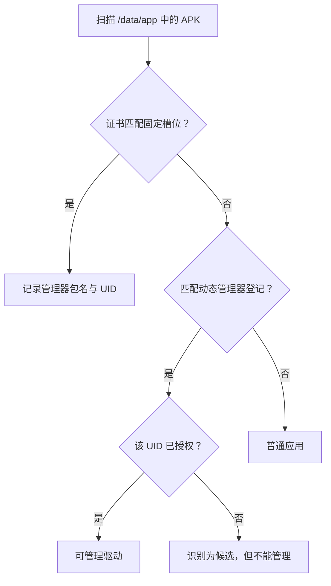

# 管理器认证失败

<Badge text="签名即身份" type="warning" /> <Badge text="包名不能证明身份" type="danger" /> <Badge text="先查 UAPI" type="tip" />

FinaSU 管理器不是一个普通的“查看器”。内核只允许受信任的管理器调用管理接口、读取驱动版本和维护授权。APK 能安装、能打开，甚至包名与官方版完全一样，也不代表当前内核接受它作为管理器。

## 先区分故障类型

:::: table 症状、边界与入口

| 现象 | 更像什么 | 先检查 |
| --- | --- | --- |
| 首页完全不显示驱动版本，且提示未安装/不支持 | 驱动未加载、KMI/分区不匹配，或管理器身份不成立 | 安装方式、启动分区、管理器证书 |
| 设备已 Root，另一个管理器能工作，但当前 APK 不能管理 | 当前 APK 的签名或 UID 没有管理身份 | 固定签名、动态管理器授权 |
| 首页能显示驱动版本，但提示更新管理器/内核 | 管理器或 `ksud` 与内核 UAPI 不一致 | 两侧版本与 UAPI 数字 |
| 能读取首页，但修改授权、模块或能力失败 | 管理接口权限、`ksud` 或具体能力问题 | 驱动运行与 SU 日志 |
| 更换 APK 后立即失效，旧 APK 再装回又恢复 | 管理身份与签名绑定 | APK 来源与证书 |

::::

::: important “管理器能打开”不是身份证明

管理器应用本身可以正常启动并显示界面。只有内核把当前 UID 识别为管理器后，首页才能读取驱动版本、内核 UAPI 和受保护的管理状态。

:::

## 管理器身份怎样建立

内核内置固定的受信任管理器签名信息，包括证书大小和 SHA-256。启动或安装变化后，内核扫描 `/data/app` 中的 APK，再通过 `/data/system/packages.list` 把包名对应到 UID。



这里有三个不同概念：

::::: field-group

:::: field 签名被识别
@type `候选`
内核认出 APK 的签名可能来自已知管理器，但不会自动授予管理权限。超级用户列表可能显示 `KSU` 候选徽标。
::::

:::: field 动态管理器已登记
@type `信任签名`
用户主动把某个 APK 的证书加入动态管理器表。签名层已经受信任；是否还要按 UID 授权，取决于当前内核是否支持独立授权表。
::::

:::: field 当前 UID 已授权
@type `实际身份`
支持独立授权表的新内核会同时检查应用 ID。旧内核把受信任签名直接视为管理身份，无法只撤销同一签名下的一个 UID。
::::

:::::

固定管理器身份和动态管理器都按 Android 用户范围折算应用 ID。工作资料、分身或另一个 Android 用户中的应用即使包名相同，也要按实际 UID 和政策判断。

## 包名为什么不能作为证据

以下情况都会让“看起来一样”的 APK 得到不同身份：

- 包名相同，但使用 debug key、个人 key 或第三方重新签名；
- 包名不同，但证书与内核记录匹配；
- 应用卸载后重装，UID 发生变化；
- 同一 APK 安装在另一个 Android 用户中；
- 动态管理器只撤销了 UID 授权，签名登记仍然保留。

因此，不要通过改包名、伪造应用标签或修改内核签名校验来“修复”认证。这些做法会削弱整个 Root 管理边界，也不能证明 APK 来源可信。

## UAPI 不匹配是另一类问题

管理器身份成立后，还要核对内核与用户态接口版本。内核与 `ksud` 不一致时，用户态会明确报出：

```text
UAPI version mismatch: kernel=<内核值>, ksud=<用户态值>. Please update KernelSU!
```

管理器首页则可能分别提示：

- **管理器 UAPI 高于内核 UAPI**：需要更新内核侧驱动；
- **管理器 UAPI 低于内核 UAPI**：需要更新管理器 APK；
- 两侧相等：才满足基本接口兼容条件。

::: warning 只更新 APK 可能不够

LKM 已加载的驱动来自启动镜像，Built-In 驱动来自当前内核；单独更新 APK 不会替换它们。反过来，换回旧管理器也不能让新内核接口自动变旧。

:::

如果根因是管理器身份而不是 UAPI，通常不会只靠看到一条版本警告解决。先确认首页是否实际显示了驱动版本和 UAPI，再判断是哪一层。

## 常见场景

:::: collapse accordion

### 安装官方 APK 后仍没有管理器身份

核对 APK 是否真的是与当前内核配套的构建。自定义签名内核必须从目标 APK 的证书重新计算 `KSU_EXPECTED_SIZE` / `KSU_EXPECTED_HASH`；只改包名或版本号不够。

### 安装了自行编译的 APK

自行编译通常会使用不同证书。若内核支持动态管理器，可在确认 APK 来源后把该 UID 设为动态管理器；若内核不支持，只能使用与内核固定槽位匹配的 APK。

### 卸载后重新安装，突然失效

重新安装可能分配新的 UID。固定管理器扫描和动态管理器授权都可能需要重新识别；动态管理器还要确认新 UID 是否在授权表中。重启通常能触发重新扫描，但不要把它当作替代核对的步骤。

### 另一个管理器能用，这一个不能用

两个 APK 可能连接同一驱动，但只有其中一个签名或 UID 被信任。不要同时让两个管理器修改授权或模块状态；先确定一个真正的管理端，再撤销另一个不需要的身份。

### 关闭动态管理器后仍显示 `KSU`

`KSU` 可能只是“预置管理器候选”徽标，不等于仍有管理权限。新内核会保留签名登记但撤销 UID；旧内核缺少独立撤销能力时，关闭开关可能删除整个签名登记。

::::

## 安全恢复顺序

:::: steps

1. **停止修改授权和模块**

   身份没有确认前，不要继续改 App Profile、安装模块或切换隐藏设置。先保存当前首页状态和时间点。

2. **确认安装方式**

   回到 LKM、Built-In 或越狱安装记录，确认当前驱动来源与版本。见[设备兼容性](/troubleshoot/compatibility/)。

3. **安装匹配管理器**

   优先使用与当前驱动同一发布构建的管理器。若设备上有多个管理器，记录每个 APK 的包名、版本、安装来源和 UID。

4. **检查是否需要动态管理器**

   只有当前内核支持该能力、当前应用满足显示条件，并且你确认 APK 来源时，才在 App Profile 中授予动态管理器。详见[动态管理器](/manager/dynamic-manager/)。

5. **核对 UAPI 与版本**

   重新打开首页，确认驱动版本、内核 UAPI 和管理器 UAPI。提示更新哪一侧，就更新哪一侧。

6. **验证一个最小操作**

   先读取首页并执行一次只读 Root 操作，再尝试修改一个可回退的测试应用授权。不要用批量导入 Profile 验证身份。

::::

::: danger 不要为了绕过认证修改内核

关闭签名检查、伪造证书、持久修改 allowlist 或复制别人的管理状态，都会让错误构建获得完整 Root 管理能力。认证失败应通过匹配构建或显式动态管理器解决。

:::

## 需要提交什么

如果完成匹配安装后仍无法认证，报告至少应包含：

- 当前启动方式：LKM、Built-In、越狱模式；
- 管理器包名、版本号、签名来源和安装 UID；
- 首页显示的驱动版本与 UAPI；
- 另一个管理器是否能工作；
- 最近是否卸载、重装、换签名或修改动态管理器；
- “发送日志”导出的压缩包和问题发生时间。

完整字段见[提交问题报告](/troubleshoot/report/)。

## 相关页面

- [动态管理器](/manager/dynamic-manager/)：登记、授权、撤销与持久化。
- [设备兼容性](/troubleshoot/compatibility/)：驱动、KMI、ABI 与 UAPI 边界。
- [驱动运行异常](/troubleshoot/runtime/)：身份成立后的 `ksud` 和模块问题。
- [日志与反馈](/troubleshoot/logs/)：日志包中的身份与版本信息。
