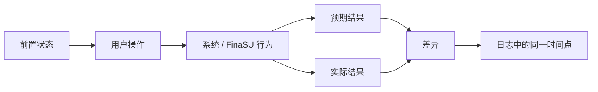

# 提交问题报告

<Badge text="一个问题一份报告" type="tip" /> <Badge text="先做最小复现" type="warning" /> <Badge text="不要公开密钥" type="danger" />

维护者需要的是可复现事实，而不是一份很大的附件。问题报告应让另一个没有接触过设备的人仅凭文字和日志，就能判断故障层级、重复相同操作，并知道哪些结果与预期不同。

## 提交前先完成三件事

:::: steps

1. **排除安全救援状态**

   如果设备仍无法开机，先按[无法开机](/troubleshoot/bootloop/)和[救砖](/guide/rescue-bootloop/)恢复。启动链问题不要混在一个普通功能报告里。

2. **做一次最小复现**

   只保留必要模块与设置，记录相同操作的预期结果和实际结果。若问题只在打开多个隐藏开关后出现，也应写明最小组合。

3. **保存原始日志**

   复现后立即导出“发送日志”，同时保留关键错误文本、时间点和必要的 `logcat` / `dmesg`。不要先清理日志或重装全部模块。

::::

## 必填环境

:::: table 报告中的环境字段

| 字段 | 示例 | 从哪里获取 |
| --- | --- | --- |
| 设备型号与产品名 | 品牌、型号、`ro.product.device` | 管理器信息卡或 `getprop` |
| Android 版本与构建 | Android 15、完整 fingerprint | 系统设置或 `basic.txt` |
| 内核完整版本 | `uname -r` 全文 | 管理器或终端 |
| KMI | 例如 `android15-6.6` | 首页 / `ksud boot-info current-kmi` |
| ABI | `arm64-v8a` 或 `x86_64` | 系统与 APK 信息 |
| 安装方式 | LKM、Built-In、越狱模式 | 首页运行方式与安装记录 |
| 修改的启动分区 | `boot`、`init_boot`、`vendor_boot`、无 | 安装页、备份或刷写日志 |
| 管理器版本 | 版本名、版本码、UAPI | 首页 / 关于 |
| 驱动版本与 UAPI | 首页状态卡 | 首页 / 诊断包 |
| 当前槽位 | A/B 设备的 `a` 或 `b` | `fastboot getvar current-slot` 或管理器 |
| 最近改动 | 模块、Profile、主题、OTA、隐藏设置 | 用户记录 |

::::

::: warning 不要只写“最新版”

“最新版”不是可核查版本。管理器、`ksud`、驱动、内核和模块都应写出实际版本；如果不确定，直接附上首页与诊断信息。

:::

## 复现信息

一份可处理的复现至少包括：

- **前置条件**：系统、运行模式、模块、Profile、安全模式和外部提供者；
- **操作步骤**：从打开哪个页面、点哪个按钮到执行哪个命令；
- **预期结果**：正常情况下应该看到什么；
- **实际结果**：看到的错误文本、返回码、黑屏、崩溃还是行为差异；
- **复现频率**：每次、首次启动、仅重启后、仅特定应用或偶发；
- **最近一次正常时间**：哪次改动后开始出现；
- **是否可回退**：关闭哪一项后问题消失。



如果无法稳定复现，明确写出尝试次数、成功/失败次数和触发条件。不要用“有时候不行”代替频率。

## 可复制的报告模板

下面的内容可以直接粘贴到问题页面，并按实际情况填写：

````markdown
## 问题摘要

用一句话说明哪个功能在哪个条件下失败。

## 环境

- 设备型号 / 产品名：
- Android 版本 / 构建：
- 内核完整版本：
- KMI：
- ABI：
- 当前槽位：
- FinaSU 管理器版本 / 版本码 / UAPI：
- 驱动版本 / 内核 UAPI：
- 运行方式：LKM / Built-In / 越狱模式 / 安全模式
- 安装方式与实际修改分区：
- 使用的模块、主题、Zygisk 提供者、Sui 或 NoMount 状态：
- 最近改动及时间：

## 复现步骤

1.
2.
3.

预期结果：

实际结果：

复现频率：

最近一次正常工作是在：

## 已验证的项目

- [ ] 首页显示驱动已连接
- [ ] 管理器 Root Shell 可用
- [ ] 目标应用 UID / Android 用户已核对
- [ ] 已尝试默认 App Profile
- [ ] 已关闭最近新增的模块或隐藏设置
- [ ] 已检查 SU 日志
- [ ] 已检查本次启动的挂载 / Zygisk / Sui 状态
- [ ] 已确认没有同时运行其他 Root 实现

## 日志与附件

- 发送日志压缩包：
- 关键时间点：
- 关键错误文本：
- 额外 dmesg / logcat：
- 截图或录屏（如有）：

## 已做的恢复操作

说明是否重启、刷回镜像、切换槽位、清过缓存或重新安装。不要省略，这些操作会影响日志解释。

## 其他说明

设备特有行为、是否只在 OTA 后出现、是否能稳定回退等。
````

## 日志附件怎样给

优先提供 `KernelSU_bugreport_*.tar.gz`。它能一次覆盖管理器版本、运行模式、模块状态、进程、挂载、内核日志和系统属性。

如果完整包过大或含敏感信息：

- 提供与问题时间对应的 `dmesg`、`logcat` 和 SU 日志片段；
- 提供 `basic.txt`、`modules.json` 和 `mount.log` 的相关部分；
- 明确说明删除了哪些文件或字段，不要悄悄修改内容；
- 保留原始时间、UID、PID、退出码和错误文本的上下文。

见[日志与反馈](/troubleshoot/logs/)中的完整清单和采集命令。

## 什么信息不要公开

:::: collapse accordion

### 密码、密钥与凭据

管理器密码、WebDAV 密码、应用锁 PIN、token、私钥、备份密钥和签名密钥都不能公开或提交到仓库。

### 设备序列号与账户信息

序列号、广告 ID、账户名、手机号、内网地址和不必要的安装来源应删除或替换。替换时要保持一致，便于跨日志关联。

### 不必要的完整 allowlist

`allowlist.bin` 包含授权与 App Profile 数据。若与问题无关，可只提供目标 UID 的状态；若需要完整包，先与维护者确认传递渠道。

### 安全漏洞细节

如果问题涉及签名绕过、任意提权、跨用户权限、日志泄露或可复现的防线绕过，不要直接公开利用步骤、PoC 或完整利用参数。先通过项目维护者指定的私密渠道联系。

::::

## 好报告与坏报告

::::: field-group

:::: field 好报告
@type `可行动`
“LKM，android14-6.1，目标 UID 10123 已显示 Root，重启应用后仍无法访问某路径；SU 日志中该 UID 的 Root execve 返回 Permission denied；默认 Profile 正常，自定义 Profile 开启 SELinux 域后复现。”
::::

:::: field 坏报告
@type `无法定位`
“Root 坏了，最新版也不行，求助。”
::::

:::: field 好日志
@type `时间线清楚`
同时包含问题发生前后的操作、相同 UID 的事件、返回码和相关状态。
::::

:::: field 坏日志
@type `缺失上下文`
只发一张裁剪掉时间和包名的截图，或只贴最后一行 `Permission denied`。
::::

:::::

## 提交前检查

:::: steps

1. 标题能说明现象和层级，不只写“求助”或“Bug”。
2. 一个问题一份报告，不把启动、模块和检测问题混在一起。
3. 环境字段使用实际版本，不写“最新”。
4. 复现步骤能让别人照着执行。
5. 预期结果和实际结果分开写。
6. 日志时间与复现时间能对应。
7. 敏感信息已经删除或替换。
8. 明确列出已经尝试过的恢复操作。

::::

:::: chat title="问题报告快速问答"
{用户}
我可以只发“发送日志”压缩包吗？

{.}
可以把它作为主要附件，但仍要写问题摘要、复现步骤、预期结果和实际结果。没有文字上下文，维护者很难知道该看哪个时间点。

{用户}
日志包太大怎么办？

{.}
先说明完整包为什么不能直接提供，再按问题层提供对应文本。不要为了缩小体积删除所有 UID、时间和错误行。

{用户}
问题已经通过清空数据解决，还要报告吗？

{.}
如果仍能描述现象和改动前的版本，可以报告。明确说明现场数据已清除，避免把“无法复现”误认为问题不存在。
::::

## 相关页面

- [日志与反馈](/troubleshoot/logs/)：诊断包内容、采集和隐私。
- [排错总览](/troubleshoot/)：先判断故障层级。
- [设备兼容性](/troubleshoot/compatibility/)：准备环境字段。
- [驱动运行异常](/troubleshoot/runtime/)：运行层问题与只读检查。
