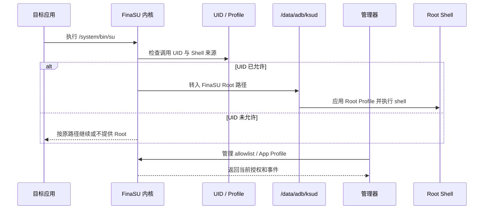
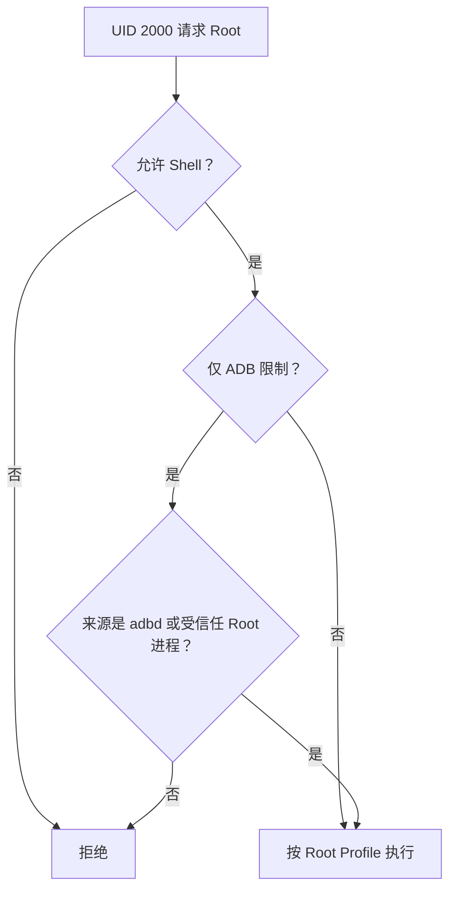

# Root 授权请求不出现

<Badge text="按 UID 生效" type="warning" /> <Badge text="先看请求记录" type="tip" /> <Badge text="Shell 有额外来源检查" type="danger" />

“没有弹窗”不一定表示 Root 驱动坏了。应用可能没有发起 Root 请求、请求使用的是 Sui 而不是传统 `su`、当前 UID 已有授权、管理器不在可响应状态，或者 Shell 被来源策略拒绝。排查时先把“应用请求”“内核判定”“管理器授权”和“Root 命令执行”分开。

## 一次传统 Root 请求经过什么

管理器负责管理授权与策略，但传统 `su` 是否能进入 FinaSU 路径，首先由内核根据当前 UID、allowlist、Shell 来源和 Profile 判断。不要把“内核通知管理器弹窗”当作唯一工作模型。

::: important 没有弹窗也可能是正常结果

如果该 UID 已经允许 Root，应用可以直接进入 Root 上下文；如果应用从未调用 `su` 或 Root API，也不会有请求记录。先确认应用实际发起了什么，再判断授权界面是否异常。

:::

## 第一层：管理器还能不能管理 Root

管理器自己的 Root Shell 是维护授权、读取模块和修改 Profile 的管理通道。它通常优先使用 `/data/adb/ksud debug su`，失败后才尝试 PATH 中的 `su`。普通 `sh` 回退不会被管理器视为可用的 Root Shell。

:::: table 这一层的判断

| 状态 | 含义 | 下一步 |
| --- | --- | --- |
| 首页有驱动版本，Root Shell 正常 | 管理通道基本成立 | 继续检查目标应用、UID 和日志 |
| 首页有驱动版本，Root Shell 不可用 | 可能是 `ksud` 缺失、UAPI 不匹配或启动阶段未完成 | 看[驱动运行异常](/troubleshoot/runtime/) |
| 首页没有驱动版本 | 驱动或管理器身份尚未成立 | 看[管理器认证失败](/troubleshoot/manager-auth/) |
| 引擎能力页全部不可用 | 先不要看应用检测 | 回到驱动和 `ksud` 基础层 |

::::

不要通过手工复制另一个版本的 `ksud` 来恢复管理通道。内核、`ksud` 和管理器的 UAPI 必须一致。

## 第二层：目标 UID 是否有授权

Root 授权按 UID 保存。管理器显示的应用名称只是辅助，真正生效的是当前进程的 UID。

:::: steps

1. **在超级用户页找到应用**

   搜索包名，必要时打开“显示系统应用”。先确认当前条目与设备上的应用版本一致。

2. **进入 App Profile**

   Root 开关在应用详情页，不在列表右侧。打开或关闭后，页面应能读回新的状态。

3. **核对 Android 用户**

   工作资料、分身和其他用户中的应用可能有不同 UID。不要只在主用户里授权，却从另一个用户中的同名应用验证。

4. **核对共享 UID**

   多个包共享 UID 时，授权影响的是整个 UID。详情页的“影响以下应用”应列出所有受影响包。

5. **重新启动目标应用**

   某些应用只在启动时检测一次 Root。授权后先彻底停止再打开，避免应用继续使用旧缓存。

::::

## 第三层：请求有没有到 SU 日志

打开 **超级用户 → 左上角 SU 日志**，按发生时间查看：

- **传统 SU**：应用通过 `/system/bin/su` 兼容入口请求 Root；
- **Root execve**：进程在 Root 上下文中执行命令；
- **授予 Root**：管理通道下发了 Root 授权；
- **守护进程重启**：日志守护进程启动或恢复；
- **Dropped**：内核事件队列丢失了记录。

:::: table 日志结果怎样解释

| 日志情况 | 更可能的原因 |
| --- | --- |
| 没有目标应用的任何记录 | 应用未请求、请求发生在日志开启前、UID 不匹配，或使用 Sui 等另一条路径 |
| 有传统 SU，但结果失败 | 授权、Shell 来源、Profile 或 `ksud` 执行失败 |
| 有 Root execve，但命令非零退出 | Root 已进入，失败来自命令、文件权限、SELinux 或应用逻辑 |
| 只有 DROPPED 或日志中断 | 不能据此断定“没有请求”；降低噪声后重新复现 |
| 授权已允许，但日志时间在问题之后 | 应用可能缓存了更早的失败结果，需要重启应用再试 |

::::

见[SU 日志](/manager/su-log/)了解事件字段和筛选方式。

## 第四层：特殊 UID 与 Shell 来源

内核不会允许所有 UID 无条件取得 Root：

- 大多数低于 `2000` 的 UID 会被拒绝，`system`（1000）是例外；
- 管理器 UID 始终允许；
- `shell`（2000）可以被“允许 Shell”放行；
- 开启“限制 Shell 仅可通过 ADB 获取 Root”后，`shell` 还必须来自允许的来源。

这主要影响终端应用、脚本、ADB 和模块启动的子进程。

如果只有终端应用出问题，而普通应用授权正常，优先检查[安全设置 → 限制 Shell 仅可通过 ADB 获取 Root](/setting/security/)和目标进程的父进程来源。

## 第五层：授权成功但应用仍说没有 Root

“允许 Root”只表示该 UID 可以进入 Root Profile。之后还可能失败：

- 自定义 UID/GID 或 groups 与应用预期不同；
- capability 被裁剪，应用无法执行 `mount`、`chown` 等操作；
- SELinux 域或额外规则限制目标路径；
- 挂载命名空间与应用预期不一致；
- 应用只检查固定路径的 `su`、特定版本号或固定发行标识；
- 应用自身缓存了授权前的结果；
- 应用使用 Sui，但 Sui 权限或 Zygisk 后端尚未就绪。

先临时切回默认 Root Profile 验证。若默认 Profile 成功，再逐项恢复自定义字段；不要一次改回整份导入的模板。

## Sui 与传统 Root 请求的区别

Sui 是 Shizuku API 兼容后端，不是传统 `su` 授权弹窗的别名。应用可能：

- 通过 Sui 请求 Root 或 Shell 权限；
- 通过 Zygisk 服务连接 Sui；
- 在 Sui 中拥有独立权限记录。

如果应用明确使用 Sui：

1. 检查 FinaSU 驱动是否可用；
2. 检查本次启动是否有实际可用的 Zygisk 提供者；
3. 检查 Sui 服务状态和目标应用权限；
4. 再检查传统 SU 日志。

详细状态见[Sui](/builtin/sui/)。外部兼容 Zygisk 提供者可以运行 Sui，但 FinaSU 无法验证该外部提供者的注入结果。

## 推荐排查顺序

:::: steps

1. **确认驱动连接**

   首页没有驱动版本时，不要继续查应用设置。

2. **确认管理器 Root Shell**

   管理器无法维护 allowlist 时，先修 `ksud` 或 UAPI。

3. **确认应用和 UID**

   核对包名、Android 用户、共享 UID、重装后的 UID 变化。

4. **触发一次可识别请求**

   使用目标应用实际调用 `su` 或 Root API 的功能，记录准确时间。

5. **查看 SU 日志**

   区分“没有请求”“请求被拒绝”“Root 后命令失败”和“日志丢失”。

6. **检查 Shell 来源**

   只有 `shell` 或终端场景才重点看 ADB 来源限制。

7. **用默认 Profile 验证**

   自定义 UID、能力、SELinux 和命名空间出错时，默认 Profile 是必要的对照。

8. **最后检查应用自身行为**

   如果 Root Shell、SU 日志和默认 Profile 都正常，再考虑应用缓存、固定 Root 实现识别或检测逻辑。

::::

## 相关页面

- [超级用户](/manager/superuser/)：查找应用、UID 和 Root 开关。
- [App Profile](/manager/app-profile/)：权限、SELinux、命名空间和非 Root 可见性。
- [SU 日志](/manager/su-log/)：请求、授权和执行结果。
- [安全设置](/setting/security/)：Shell 来源限制与 ADB Root。
- [管理器认证失败](/troubleshoot/manager-auth/)：首页没有驱动身份。
- [驱动运行异常](/troubleshoot/runtime/)：`ksud` 与运行模式异常。
