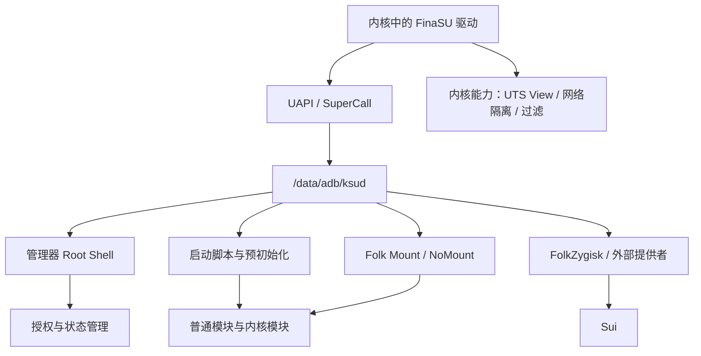
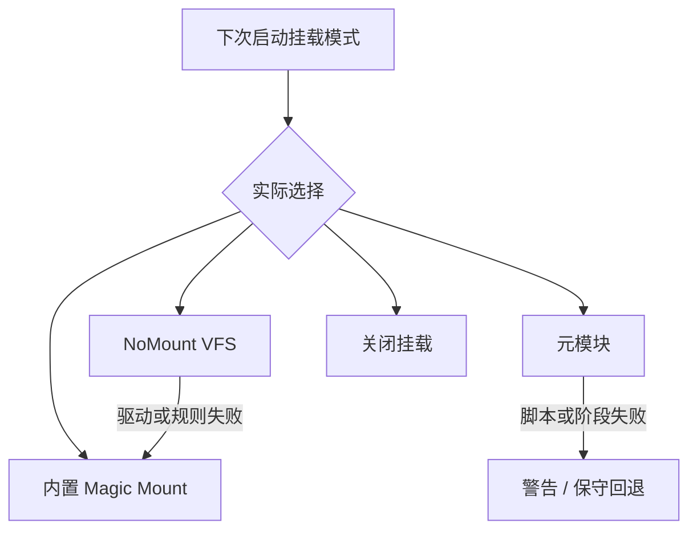

# 驱动运行异常

<Badge text="驱动先于功能" type="tip" /> <Badge text="配置不等于本次状态" type="warning" /> <Badge text="不要拼载荷" type="danger" />

这里讨论“管理器已经能看到驱动，但运行仍不符合预期”的问题。如果首页根本不显示驱动版本，先看[管理器认证失败](/troubleshoot/manager-auth/)；如果设备无法启动，先看[无法开机](/troubleshoot/bootloop/)。

## 先画清运行链



任何一层失败，都可能让管理器页面看起来“能开但不好用”。先确认故障发生在哪个箭头，再决定是否重启、更换配置或重新安装。

## 常见现象定位

:::: table 从现象进入对应层

| 现象 | 优先检查 | 页面 |
| --- | --- | --- |
| 首页没有驱动版本、未安装或不支持 | 启动分区、KMI、管理器身份 | [设备兼容性](/troubleshoot/compatibility/)、[管理器认证失败](/troubleshoot/manager-auth/) |
| 首页有版本，但 Root Shell 一直不可用 | `ksud`、UAPI、Root Shell 回退 | 本页 |
| 应用没有 Root | UID、Profile、Shell 来源、请求记录 | [Root 授权请求不出现](/troubleshoot/root-request/) |
| 模块开关保存了但文件或脚本没生效 | 本次启动、挂载提供者、脚本、安全模式 | 本页 |
| Zygisk 状态异常 | 外部提供者、ABI、注入回执、启动保护 | [FolkZygisk](/builtin/folkzygisk/) |
| Sui 不可用 | Zygisk 后端、Sui 状态、应用权限 | [Sui](/builtin/sui/) |
| NoMount 回退或规则为 0 | 驱动、KMI 资产、例外 UID、模块贡献 | [NoMount](/builtin/nomount/) |
| 内置能力显示不支持 | 内核特性、配置、外部提供者 | [内置能力总览](/builtin/) |
| 导入 `.ko` 失败或没有加载 | 架构、vermagic、依赖、状态记录 | [内核模块](/manager/kernel-module/) |

::::

## 首页有版本，但 Root Shell 不可用

管理器自己的 Root Shell 主要验证三件事：

1. 内核接口能完成管理操作；
2. `/data/adb/ksud` 能被执行；
3. 执行结果确实获得 UID 0，而不是退回普通 `sh`。

管理器不会把普通 Shell 标记为 Ready。它会先尝试 `/data/adb/ksud debug su`，失败后才尝试 PATH 中的 `su`，并有重试与退避。持续不可用时，不要只看“应用已经 Root”这一句话。

:::: collapse accordion

### `ksud` 缺失或不可执行

检查 `/data/adb/ksud` 是否存在，以及是否来自当前发布载荷。正式修复方式是安装与内核匹配的完整发布包；不要从其他 APK 手工复制一个版本不明的 `ksud`。

### UAPI 不匹配

内核与 `ksud` 的接口版本不一致时，用户态会报：

```text
UAPI version mismatch: kernel=<内核值>, ksud=<用户态值>. Please update KernelSU!
```

此时重启不会改变接口版本。通过更新匹配的管理器、启动镜像或内核来对齐两侧。

### 安全模式正在生效

安全模式会跳过大量模块和内置能力启动流程。Root 管理通道可能仍可打开，但模块、挂载、Zygisk 和 Sui 的状态不能按正常启动判断。

### 启动尚未完成

刚开机时，`ksud`、挂载和引擎状态可能仍在初始化。先等待系统稳定并刷新页面；如果状态长期停在 Starting，再按失败处理。

::::

## 模块不生效

模块问题至少分三层：

::::: field-group

:::: field 模块状态
@type `是否参与启动`
模块可能被禁用、标记待删除、正在更新，或被安全模式批量禁用。
::::

:::: field 文件挂载
@type `模块文件是否可见`
即使脚本执行，模块的 `system/` 文件也不一定会出现在目标应用视图中。Folk Mount、NoMount、元模块和 App Profile 都会影响结果。
::::

:::: field 脚本与内核对象
@type `启动逻辑是否运行`
`post-fs-data.sh`、`service.sh`、预初始化和受管 `.ko` 是不同执行阶段。文件挂载成功不代表脚本成功，脚本成功也不代表内核模块已加载。
::::

:::::

先看本次启动记录，而不是只看“启用”开关：

- **配置模式**：下次启动想使用什么；
- **本次启动提供者**：这次实际由谁完成挂载；
- **回退原因**：NoMount、元模块或驱动失败后是否退回内置引擎；
- **预初始化状态**：配置是否同步、是否连续启动失败；
- **安全模式**：是否跳过了脚本和挂载。

::: tip 只对一个应用不可见时

先检查该应用的 App Profile。默认非 Root Profile 的“卸载模块”为开启状态；NoMount 则使用另一套例外 UID 语义。不要先更换全局挂载模式。

:::

## 挂载提供者异常

Folk Mount 有多种模式，本次启动的提供者可能与配置不同：



页面显示回退时，先阅读警告和[Folk Mount](/builtin/folk-mount/)说明。配置仍可能写着 NoMount，但这次由内置引擎完成挂载；这不表示设置没有保存，而是本次启动的降级结果。

NoMount 驱动加载成功还需要 API 探测通过。加载调用返回、`/proc/modules` 出现名字，都不等于驱动能接收规则。详细状态可用：

```sh
/data/adb/ksud nomount status --json
```

## FolkZygisk 与 Sui

### FolkZygisk

需要区分：

- “下次启动已启用”：只是配置；
- “本次启动已注入/部分注入/失败/未验证”：当前启动的真实结果；
- “外部提供者接管”：内置引擎按设计让位；
- “启动保护已暂停”：连续失败后不再自动尝试。

只有当前启动显示已注入，并覆盖目标应用所需 ABI，才能认为 FolkZygisk 完成了自己的注入检查。外部提供者接管时，Sui 仍可能运行，但 FinaSU 无法验证外部提供者的注入结果；到外部模块自己的入口检查。

### Sui

Sui ==依赖可用的 Zygisk 后端==。FinaSU 驱动正常、FolkZygisk 开关打开，都不自动等于 Sui 已经可用。还要检查：

- 本次启动是否真有 Zygisk 提供者工作；
- Sui 服务是否处于可用状态；
- 目标应用是否获得 Sui 的 Root 或 Shell 权限；
- 管理器身份与通知条件是否满足。

完整诊断见[Sui](/builtin/sui/)。

## 内核能力不可用

管理器能显示某个功能，不代表当前内核实现了它。不同功能有不同门控：

- **挂载视图过滤**需要在当前内核成功安装 proc 展示 hook；
- **UTS View**需要对应内核特性，SUSFS 接管时还可能改变可用状态；
- **网络隔离**需要内核侧规则接口；
- **SUSFS**只对接已有的源码集成或匹配的 SUSFS-LKM；
- **NoMount**需要当前 KMI 的资产或内核内建驱动。

如果功能显示 `unsupported`、`unavailable` 或强制/托管状态，先按对应页面检查。不要通过手改 JSON 或内部状态文件把按钮强行改成开启。

## 导入 `.ko` 后没有效果

导入与自动加载不是同一件事：

- 导入只保存文件与配置；
- 启用或设为自动加载决定后续启动是否尝试；
- 实际加载还要匹配架构、KMI、vermagic、符号依赖和内核配置；
- 安全模式禁止加载受管内核模块；
- 上一条目的失败原因比 `/sys/module` 是否存在更可靠。

不要重复执行 `insmod` 猜测状态，也不要加载来源不明的模块。先看[内核模块](/manager/kernel-module/)中的“上次结果”和系统日志。

## 推荐的只读检查

```sh
/data/adb/ksud boot-info current-kmi
/data/adb/ksud module list
/data/adb/ksud nomount status --json
ls -l /data/adb/ksud /data/adb/ksu/log
```

如果命令本身报 UAPI 不匹配，停止继续尝试模块或内置能力。先修复驱动与用户态版本关系。

```file-tree title="运行状态与日志位置"
/data/adb
├── ksud                         # 用户态管理载荷
├── modules/                     # 普通模块
├── modules_update/              # 待合并更新
└── ksu/
    ├── log/
    │   ├── mount.log            # 挂载与回退记录
    │   ├── mount_capture.log    # 启动异常捕获（启用后）
    │   └── sulog-*.log          # Root 事件
    ├── mount_mode               # 下次启动挂载模式
    ├── mount_runtime            # 本次启动提供者
    ├── nomount_runtime          # 本次 NoMount 结果
    ├── preinit_status           # 预初始化状态
    ├── .allowlist               # 授权和 Profile
    └── .dynamic_manager         # 动态管理器登记
```

这些文件用于诊断。直接编辑可能绕过事务、锁和一致性检查，也让管理器显示与内核实际状态不一致。

## 什么时候选择“修复”或重装

以下情况适合安装匹配的完整发布包：

- 内嵌 `ksud`、FolkZygisk、Sui 或 NoMount 载荷缺失；
- 管理器提示引擎文件缺失或资产损坏；
- 设备上的 `ksud` 被手工替换、权限异常或版本不明；
- 内核和管理器已确认 UAPI 不匹配，且更新方向明确。

以下情况重装 APK 不会解决：

- 启动镜像或 Built-In 内核不匹配；
- 安全模式仍在生效；
- 模块脚本或第三方模块本身损坏；
- 外部 Zygisk 提供者接管；
- 某个内核特性根本没有编入当前内核。

## 相关页面

- [设备兼容性](/troubleshoot/compatibility/)：KMI、ABI 和能力门控。
- [管理器认证失败](/troubleshoot/manager-auth/)：签名与 UAPI 身份层。
- [Root 授权请求不出现](/troubleshoot/root-request/)：应用授权和 Shell 来源。
- [Folk Mount](/builtin/folk-mount/)：提供者选择与回退。
- [NoMount](/builtin/nomount/)：驱动、规则和例外 UID。
- [FolkZygisk](/builtin/folkzygisk/)：注入状态与启动保护。
- [Sui](/builtin/sui/)：Zygisk 依赖、权限和服务状态。
